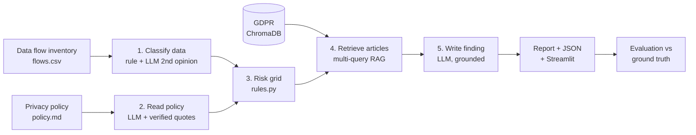

# PrivacyGap — AI-assisted GDPR audit of health apps

**PrivacyGap compares what an app *promises* in its privacy policy with what it *actually does* with personal data, and justifies every risk with the text of the GDPR.**

It runs fully on a laptop: local LLM (Ollama), local embeddings, local vector database. No data leaves the machine, which matters for a tool that reads sensitive data flows.

> Audit-support tool built as a portfolio project. It does not give legal advice; every finding is meant to be reviewed by a human.

## Why

In 2019 the *Wall Street Journal* revealed that **Flo**, a period-tracking app used by more than 100 million people, sent menstrual and pregnancy data to Facebook and other analytics companies, while its privacy policy said that health data would not be shared. This led to an FTC settlement (2021) and a US class action: on 1 August 2025 a jury found Meta liable under the California Invasion of Privacy Act, after Flo, Google and Flurry had settled.

The gap was simple to state: **policy says X, data flows do Y**. Finding it by hand means reading the policy, the data inventory and the law together. PrivacyGap automates the first pass of that audit and keeps a human in the loop.

## What it does

For each data flow of an app (data → recipient → purpose → consent), PrivacyGap:

1. **Classifies the data.** A keyword rule decides whether the data falls under special categories (health, sex life, GDPR art. 9). The LLM gives a second opinion, and if the two disagree the flow is flagged for human review.
2. **Reads the privacy policy.** The LLM answers two narrow questions ("which commitment allows this flow?", "which commitment forbids it?") and must back each answer with an **exact quote**. The code then checks where the quote really comes from. Unverifiable answers are rejected.
3. **Sets the risk level** (high, medium or low) with an auditable rule grid, with reasons attached.
4. **Retrieves the relevant GDPR articles** through RAG (multi-query search in ChromaDB) and checks that every article the decision relies on was actually retrieved.
5. **Writes the finding**: a justification and recommendation grounded only in the retrieved legal passages.

Output: a Markdown audit report per app, JSON results, and a Streamlit interface.



**Design principle: the LLM reads and writes; code decides.** Structured decisions (risk level, contradiction) are made by deterministic, explainable code. The LLM handles the language tasks (reading a policy, finding the matching sentence, writing the explanation), and its outputs are validated with Pydantic and checked against the source.

## Results

Evaluated on **26 data flows across 3 cases**, against a ground truth written *before* running the tool:

| Case | Description | Flows |
| --- | --- | --- |
| `flo` | Flo Health (2016–2019), reconstructed from the FTC complaint, the 2025 trial and press coverage | 11 |
| `control_app` | *ClearCycle*, a fictional app that does things right. Tests false alerts | 8 |
| `trap_app` | *StepWell*, a fictional app with subtle problems (non-EU transfer, vague retention, wording traps) | 7 |

**Iterations (same dataset, same model `qwen2.5:3b`):**

| Version | Change | Risk level correct | Contradiction correct | False alerts |
| --- | --- | --- | --- | --- |
| baseline | LLM classifies data and judges the policy | 77% | 58% | 6 |
| two_questions | Two narrow policy questions with quotes | 77% | 54% | 6 |
| **quote_located** | **Rule grid + code verifies where each quote comes from** | **100%** | **81%** | **0** |

Final version, all cases: issue recall 100%, issue precision 100%, contradiction precision 69%, GDPR article recall 93%.
Retrieval alone: the expected article is in the top 5 for 9 of 10 test questions (hit@5 = 90%).
Speed: about 30 s per flow on a laptop CPU (Intel i5, 16 GB RAM, no GPU needed).

**What these numbers mean, honestly:**
- The 100% risk accuracy is partly circular. The rule grid and the ground truth follow the same audit logic, so this mostly shows that the grid is applied consistently. **The real test of the AI is contradiction detection (81%)**, where the model has to read and interpret a policy.
- 26 flows is a small sample. These are indicators, not statistical proof.
- The Flo flows are reconstructed from public sources. Apart from `R_SELECT_LAST_PERIOD_DATE`, internal event names are not public. The GDPR analysis of Flo is hypothetical: the real case was judged under US law.
- The remaining errors are mostly false contradictions: a 3B model sometimes misses a commitment that does announce the flow. A larger model (`qwen2.5:7b`) is the obvious next experiment.

## Quick start

Requirements: Python 3.11, [Ollama](https://ollama.com), about 3 GB of disk space.

```bash
git clone https://github.com/<your-username>/privacygap.git
cd privacygap
python -m venv .venv
.venv\Scripts\activate            # Windows   (macOS/Linux: source .venv/bin/activate)
pip install -r requirements.txt
copy .env.example .env            # Windows   (macOS/Linux: cp .env.example .env)
ollama pull qwen2.5:3b

python check_setup.py             # checks libraries, Ollama, embeddings
python -m src.ingest              # downloads and indexes the GDPR (about 300 chunks)
python -m src.audit flo           # audits a case -> reports/flo_report.md
python -m eval.evaluate           # scores against the ground truth
streamlit run app.py              # web interface
```

The audit results used for the scores above are committed in `reports/`, so the interface can be explored right after `pip install`. Ollama is only needed for a new or live audit.

Optional: set `LLM_PROVIDER=gemini` and `GEMINI_API_KEY` in `.env` to use Gemini instead of the local model.

## Project structure

```
src/
  config.py        settings (.env)
  llm.py           single access point to the LLM (Ollama or Gemini)
  ingest.py        GDPR download -> articles -> chunks -> ChromaDB
  vectorstore.py   ChromaDB collection (cosine, all-MiniLM-L6-v2)
  retriever.py     semantic search
  cases.py         loads and validates a case
  rules.py         deterministic audit grid (special categories, risk level)
  schemas.py       Pydantic models for every LLM answer
  auditor.py       the audit engine (5 steps above)
  audit.py         CLI: audit a case
  report.py        Markdown report
eval/
  evaluate.py      scores vs ground truth + history of experiments
  test_retrieval.py  retrieval hit@5
  debug_policy.py  shows raw LLM answers on the policy
data/cases/<case>/ policy.md · flows.csv · expected_findings.csv
reports/           audit reports, results, evaluation, eval_history.csv
app.py             Streamlit interface
```

## Adding a case

Create `data/cases/<name>/` with three files, then run `python -m src.cases` to validate them:
- `policy.md`: the privacy policy, with commitments numbered `**P1.**`, `**P2.**`…
- `flows.csv`: `flow_id, event_name, data_fields, recipient, recipient_type, purpose, consent, source`
- `expected_findings.csv`: `flow_id, contradicts_policy, risk_level, expected_articles, rationale`, written **before** running the audit.

## Next steps

- Compare `qwen2.5:7b` and other local models on the same evaluation.
- Add a case written blind by someone else, to remove author bias from the ground truth.
- Index the ePrivacy Directive, CNIL and EDPB guidelines alongside the GDPR.

## Credits

Built by **Safa Bougacha**. The Flo case comes from the group case study *"Flo App Scandal: Period Data Exposed"* (H. Kaur, N. Laataoui, S. Bougacha, Rennes School of Business, November 2025).

Legal texts: Regulation (EU) 2016/679 (GDPR), from EUR-Lex. Flo facts: FTC complaint (2021) and public coverage of *Frasco v. Flo Health* (N.D. Cal.).

License: MIT.
